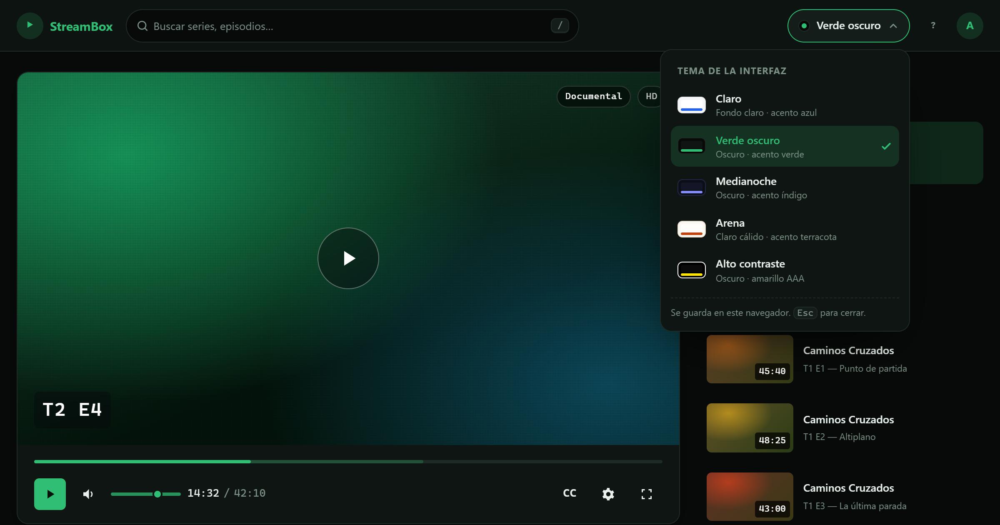

# tema-ui

Demo de interfaz de reproductor cuyo motivo de existencia es el **cambio de
tema**: cinco paletas completas, selector visual, persistencia y transición
animada. Todo sin dependencias, sin build y sin framework.

**▶ Ver en vivo:** https://alejandropd05.github.io/temaUI/

Se abre con doble clic sobre `index.html`.



---

## Qué hace

| | |
|---|---|
| **Motor de temas** | 5 temas declarados como bloques de tokens. Cambiar de tema es cambiar un atributo en `<html>`. |
| **Reproductor** | Simulación con reloj: posición, volumen, velocidad, subtítulos, calidades y pantalla completa real. |
| **Catálogo** | 9 episodios en `js/data.js`, única fuente de verdad: la lista y la búsqueda se generan de ahí. |
| **Buscador** | Filtro instantáneo, insensible a mayúsculas y a acentos, con estado vacío y región viva. |
| **Atajos** | 10 atajos de teclado con diálogo de ayuda integrado (`?`). |
| **Accesibilidad** | AA en los 5 temas, AAA en alto contraste. Foco visible, semántica nativa, `prefers-reduced-motion`. |

---

## Uso

```bash
# Opción 1: doble clic en index.html

# Opción 2: servidor local (recomendado si vas a depurar)
python -m http.server 8766
# → http://127.0.0.1:8766
```

No hay `npm install`, no hay `npm run build`. Los ficheros que hay en el
repositorio son los que se sirven.

### Atajos de teclado

| Tecla | Acción |
|---|---|
| `Espacio` | Reproducir / pausar |
| `←` `→` | −5 s / +5 s |
| `↑` `↓` | Volumen ±5 |
| `M` | Silenciar |
| `F` | Pantalla completa |
| `C` | Subtítulos |
| `/` | Buscar en el catálogo |
| `T` | Cambiar de tema |
| `?` | Ayuda de atajos |
| `Esc` | Cerrar menús y diálogos |

Los atajos **no** se disparan mientras el foco está en un campo de texto, ni
cuando el foco recae en un botón que ya reacciona a `Espacio` (si no,
`Espacio` alternaría dos veces y se anularían).

---

## Estructura

```
index.html          Marcado semántico + script en línea que aplica el tema
                    ANTES de pintar (evita el destello claro al abrir)
css/
  base.css          Escala de diseño, reinicio, foco, reduced-motion
  themes.css        ★ Los 5 temas: sólo tokens de color
  layout.css        Cabecera, rejilla, menú de temas, diálogo de atajos
  player.css        Reproductor, controles y lista
js/
  data.js           Catálogo, formato de tiempo y filtrado
  themes.js         ★ Motor de temas
  player.js         Estado del reproductor
  app.js            Pegamento: lista, búsqueda, atajos, arranque
assets/
  favicon.svg
  og-cover.png
```

Orden de carga fijado en `index.html`:

```css
base.css → themes.css → layout.css → player.css
```
```js
data.js → themes.js → player.js → app.js
```

---

## El sistema de temas

### Cómo funciona

`css/themes.css` declara los mismos tokens para cada valor de `data-theme`:

```css
html[data-theme='verde-oscuro'] {
  --bg: #070a08;
  --surface: #0e1512;
  --accent: #2fbe73;
  --accent-contrast: #04120a;
  /* … */
}
```

`js/themes.js` **sólo cambia ese atributo**. No inyecta `<style>`, no escribe
colores en línea. La composición (`layout.css`, `player.css`) jamás nombra un
color literal: llama a `var(--surface)`, `var(--accent)`…

> **Antes**, el «tema verde oscuro» era un string de CSS que se colgaba de
> `<head>` y volvía a declarar `:root` entero. Cualquier token añadido después
> se rompía en silencio, y era un único tema alternativo.

### Añadir un tema

1. Copia un bloque en `css/themes.css` y cámbiale el id y los tokens.
2. Añade una entrada en `THEMES` de `js/themes.js`.
3. Añade el `<button class="theme-option">` correspondiente en `index.html`.
4. Añade el `[data-swatch='…']` con los colores de su miniatura.
5. Regístralo en el array `THEMES` del script en línea del `<head>`.

Nada más. Ni una regla de composición cambia. El QA (`temas`, `contraste`)
fallará si olvidas uno de los pasos o si algún par de colores baja de AA.

### Detalles que no son decorativos

- **Sin destello al abrir.** El script del `<head>` lee `localStorage` y pone
  `data-theme` de forma síncrona. Si no hay elección guardada, sigue
  `prefers-color-scheme`.
- **La elección del usuario manda.** Al elegir un tema a mano se marca
  `tema-ui:manual`; sin esa marca, un cambio del sistema se aplica solo.
- **Transición acotada.** `document.startViewTransition()` cuando existe y
  `prefers-reduced-motion` lo permite. Sólo se anima color: pintar posición
  obligaría a rasterizar el lienzo del vídeo entero y se nota como un tirón.
- **La paleta se congela para capturar.** View Transitions saca el snapshot
  nuevo en el *siguiente fotograma* de la callback, así que si la paleta
  estuviera interpolando —`layout.css` declara un `transition` de 260 ms para
  cuando no hay View Transition—, el snapshot saldría con los colores viejos:
  el fundido cruzaría dos imágenes iguales, no se vería nada durante 260 ms y
  el color nuevo aparecería de golpe al quitar los snapshots. `themes.js`
  pone la clase `theme-vt` antes de capturar y la quita al `finished`. Si no
  hay View Transition, no se bloquea nada: ahí esas transiciones de color las
  que hacen el fundido.
- **Los menús se coordinan.** Abrir uno despacha `tema-ui:close-menus` en
  `document` *antes* de mostrarse, para que el propio listener no se cierre a
  sí mismo en el mismo tick.

---

## Por qué no hay módulos ES

`import`/`export` requieren servidor: bajo `file://` el navegador los bloquea
por CORS y la página se queda en blanco. Al ser un demo pensado para abrirse
con doble clic, cada fichero es una IIFE clásica que publica en
`window.TemaUI`.

La suite `file` del QA comprueba exactamente esto, así que si alguien
«mejora» el proyecto pasándolo a módulos, el test lo delata.

---

## Accesibilidad

- **Contraste** verificado por token en los 5 temas (no por elemento: los
  contenedores suelen ser transparentes y el cálculo dependía de qué había
  detrás):

  | Tema | Mínimo |
  |---|---|
  | claro | 4,78:1 |
  | verde-oscuro | 5,51:1 |
  | medianoche | 6,49:1 |
  | arena | 4,85:1 |
  | alto-contraste | 15,00:1 (AAA, 21:1 en texto principal) |

- **Progresión y volumen son `<input type="range">` reales**: traen foco,
  flechas, arrastrar y semántica de slider sin reimplementar nada.
- **El episodio en reproducción se marca con un texto oculto** para lectores
  de pantalla: `is-current` sólo cambia de color, y el color solo no basta
  (WCAG 1.4.1).
- **`aria-valuetext` legible**: `14:32 de 42:10`, no `872`.
- **Foco visible** en todos los controles y skip link como primer tabulador.
- **Diálogo modal** con foco atrapado, `Escape` y foco devuelto al botón.

---

## Rendimiento y aceleración por hardware

El cambio de tema es la operación más cara de la demo: View Transitions hace
**dos capturas de página completa** (antes y después) y las cruza durante
260 ms. Esa rasterización va a GPU, así que con la aceleración desactivada
cae al hilo de software.

Efectos que dependen de ella:

| Efecto | Dónde |
|---|---|
| `backdrop-filter` | cabecera (blur 10px), diálogo de ayuda, botón de reproducción, código de episodio |
| `mix-blend-mode` | `.video-grain`, la capa de grano sobre la carátula |
| Las dos capturas de View Transitions | cambio de tema |

Todos degradan limpiamente si no están: la cabecera ya lleva fondo opaco
como *fallback* en `@supports`, y el grano es decorativo. No rompen nada,
sólo cuestan cuadros.

Lo que **no** depende de la aceleración —y era el problema real— es que el
cambio se viera brusco: está documentado en «La paleta se congela para
capturar», más arriba, y tiene prueba de regresión.

Coste medido en Edge headless durante un cambio de tema (ventana de 450 ms):

```
antes del fix   142 fps   (paleta interpolando durante la captura)
después         166 fps   (paleta congelada)
referencia      167 fps   (transiciones de color desactivadas del todo)
```

---

## Pruebas

El proyecto se validó con un arnés de Playwright propio que cubre **132
aserciones**. Ese arnés **no está incluido en este repositorio** (no es
dependencia del proyecto), así que los comandos de abajo sólo funcionan
donde esté presente:

| Suite | Qué comprueba |
|---|---|
| `carga` | 0 errores de consola, 0 peticiones fallidas, API completa |
| `temas` | 5 temas, menú ARIA, persistencia, `next()`, ciclos del sistema |
| `contraste` | 5 temas × 7 pares, más AAA en alto contraste |
| `reproductor` | reloj, seek, volumen, menús, subtítulos, pantalla completa |
| `busqueda` | filtro, acentos, estado vacío, región viva, sin recarga |
| `atajos` | los 10 atajos, suspensión en campos y con diálogo abierto |
| `layout` | 7 anchos sin desbordamiento horizontal |
| `facts` | hechos de layout computados en cada punto de corte |
| `accesibilidad` | nombres, etiquetas, landmarks, foco, rangos |
| `motion` | usabilidad con `prefers-reduced-motion: reduce` |
| `file` | apertura por `file://` completa |

```bash
node qa.js           # todo (requiere el arnés, fuera del repo)
node qa.js temas     # una suite
```

---

## Créditos

Ejercicio original de septiembre de 2026, reescrito en octubre de 2026.
Interfaz, catálogo y textos ficticios; no hay vídeo real, la reproducción es
una simulación con reloj.
